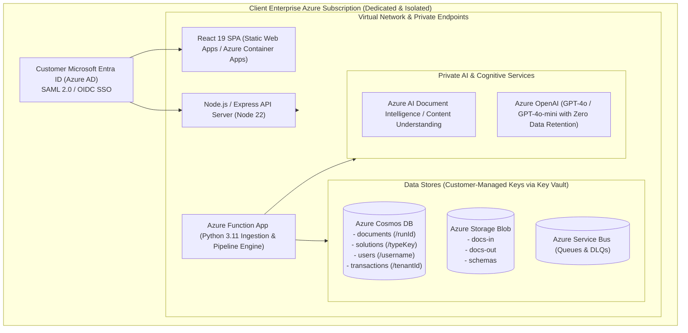
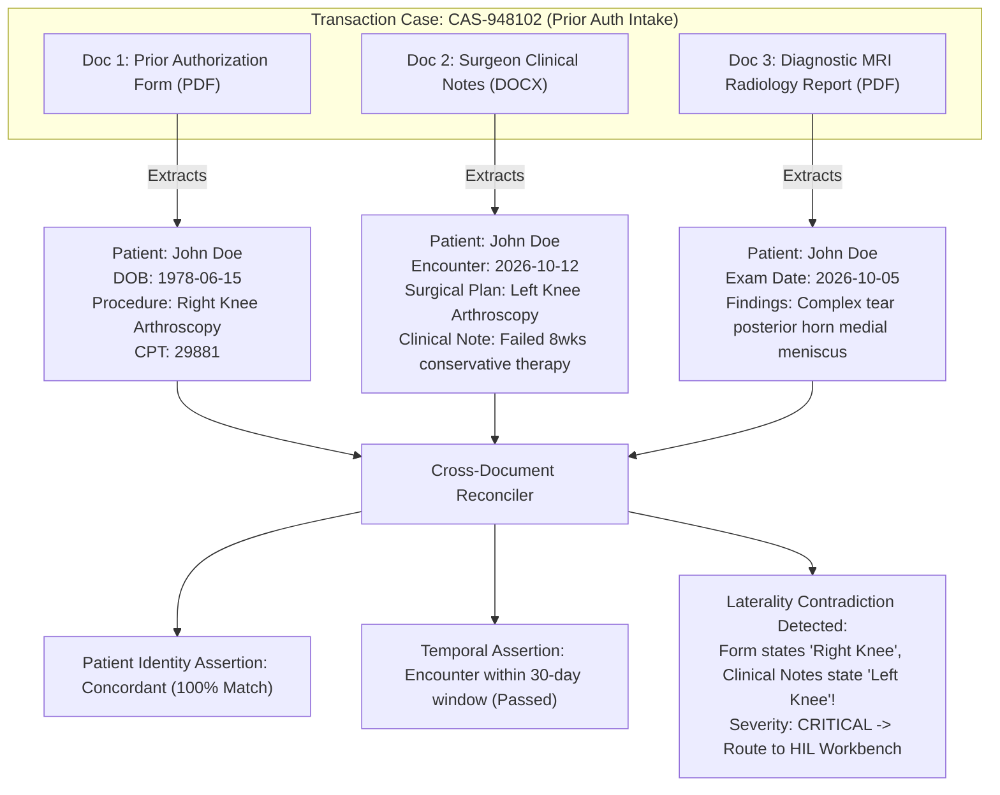

# PACCA Vision V2.0 — Master Product Requirements Document (PRD) & Technical Architecture Specification

**Product Name:** PACCA Vision V2.0 Enterprise Intelligent Document Processing (IDP) & Decision Platform  
**Target Market:** Healthcare Payers, Health Systems, Life Sciences, BPO Intake, and Regulated Financial Enterprises  
**Commercial & Delivery Model:** Customer-Hosted Single-Tenant PaaS (Deployed into Client Azure Subscription)  
**Baseline Reference:** PACCA Vision V1.0  

---

## 1. Executive Summary & Vision

### 1.1 The Market Opportunity
Enterprise organizations in healthcare, insurance, and logistics handle millions of multi-document transaction packets annually (e.g., Prior Authorization requests paired with clinical encounter notes, lab results, and denial letters; or Commercial Invoices paired with Bills of Lading and Packing Slips).

Traditional IDP solutions (ABBYY, Rossum, Hyperscience) process isolated single files with brittle OCR templates and high manual review costs. They fail at **multi-document packet understanding, cross-document contradiction detection, deterministic business rule grounding, and auditable decision execution**.

### 1.2 The V2.0 Mission Statement
> **PACCA Vision V2.0** transforms document operations into an **autonomous, explainable, multi-document Decision and Intelligence Platform**. Packets arriving from any channel are ingested into an isolated enterprise workspace, decomposed into typed documents, extracted with provenance-backed AI models, reconciled across files for clinical and financial contradictions, validated against deterministic reference codebooks, and routed to skill-based Human-in-the-Loop (HIL) only when true ambiguity exists.

---

## 2. Commercial, Deployment & Governance Boundaries

### 2.1 The Customer-Hosted PaaS Delivery Reality
Unlike public multi-tenant SaaS providers that ingest PHI/PII into a shared cloud, **PACCA Vision V2.0 is shipped as a customer-hosted PaaS solution deployed directly into the client enterprise's dedicated Azure subscription** (or an isolated managed subscription per enterprise customer).



### 2.2 Commercial Architectural Principles
1. **Infrastructure & Token Cost Ownership:** The client enterprise bears 100% of the Azure compute, storage, Cosmos RU/s, and Azure OpenAI token costs directly through their enterprise agreement.
2. **Tenancy Definition:** Tenancy inside the application does not represent separate billable SaaS customers; it represents **Internal Workspaces, Operating Entities, and Lines of Business (LOBs)** (e.g., *Medicare Advantage Prior Auth*, *Commercial Claims*, *Medicaid Intake*).
3. **Identity & Access Management:** Direct integration with **Microsoft Entra ID (Azure AD)** via SAML 2.0 / OIDC with SCIM role provisioning. Zero external user pools.
4. **Data Sovereignty & Compliance:** 
   - Zero Data Retention (ZDR) enabled on Azure OpenAI instances.
   - Customer-Managed Keys (CMK) via Azure Key Vault for all Blob and Cosmos DB data.
   - All network traffic isolated within Azure Private Link (`privatelink`).

---

## 3. Complete Module Catalogue (M01 – M13)

| Module ID | Module Name | Scope & Technical Implementation | Primary Persona | Priority |
|---|---|---|---|---|
| **M01** | **Universal Ingestion & Packet Router** | Multi-channel connectors (Blob, SFTP, Inbound Email, REST API). Multi-file packet bundling, page splitting, perceptual dedup, and image DPI quality gates. | Client Staff, Solution Dev | **P0** |
| **M02** | **Document Understanding Engine** | Multi-engine layout parser: Azure Content Understanding for scanned PDFs/TIFFs; native OpenXML parser for DOCX; native XPath parser for XML; native X12 parser for EDI 837/278. | Solution Dev, System | **P0** |
| **M03** | **Classification & Extraction Studio** | Evolved from `SolutionsV2`: Visual taxonomy builder, schema designer, nested line-item tables, confidence thresholds, and bounding-box anchor mapping. | Solution Dev | **P0** |
| **M04** | **Packet Correlation & Entity Linker** | Cross-document entity reconciliation (Patient, Provider, Service Date, Procedure). Deterministic contradiction detection across multi-file packets with bounding-box citations. | Client Staff, Solution Dev | **P0** |
| **M05** | **Grounding, Reference Data & Rules** | Two-tier validation: Tier 1 deterministic syntax & codebook lookups (ICD-10, CPT, 10-digit NPI Luhn checks); Tier 2 LLM clinical medical necessity evaluation with mandatory source citations. | Solution Dev, Client Admin | **P0** |
| **M06** | **AI Model Center & Gateway** | Per-solution model selection (GPT-4o for unstructured clinical narratives, lightweight models for structured forms), PTU token rate-limiting, and PHI protection guards. | Solution Dev, Platform Admin | **P1** |
| **M07** | **Pipeline Profile Manager** | Stage-level pipeline configuration manager (Intake $\rightarrow$ Format Parser $\rightarrow$ Classification $\rightarrow$ Extraction $\rightarrow$ Rules $\rightarrow$ HIL $\rightarrow$ Delivery). Live simulation test runner. | Solution Dev | **P0** |
| **M08** | **Golden Datasets & Regression Benchmark** | Curated ground-truth test corpora. Replay sandbox measuring exact STP%, field F1, and cost deltas before promoting schema or prompt changes to production. | Solution Dev, Platform Admin | **P1** |
| **M09** | **Integration Hub & Export Adapters** | Downstream delivery sinks: EHR FHIR R4 bundles, HL7 v2, REST writeback webhooks, and secure Blob export. Merged with M01 inbound. | Solution Dev, System | **P0** |
| **M10** | **Operations Control Tower & Transactions** | Real-time operational command center: live STP rate, SLA countdowns, queue depths, transaction packet ledger, and end-to-end trace debugging. | Client Staff, Operations Mgr | **P0** |
| **M11** | **Intelligent HIL Workbench** | Multi-document review interface with side-by-side PDF viewers, synchronized bounding boxes, grounding suggestions, and optimistic ETag (`409`) concurrency locks. | HIL Reviewer, Client Staff | **P0** |
| **M12** | **Enterprise Analytics & Continuous Learning** | Operational KPI reporting: STP rate trends, reviewer touch times, error Pareto analysis, and departmental AI cost attribution. | Operations Mgr, Admin | **P1** |
| **M13** | **Enterprise Workspaces & Governance** | Line-of-Business workspace provisioning, Entra ID RBAC/ABAC mapping, immutable audit logs, and compliance policy management. | Platform Admin | **P0** |

---

## 4. Detailed Functional Specifications

### 4.1 Ingestion & Format Dispatcher (M01 / M02)
- **Supported Formats & Parsing Strategies:**
  1. **PDF / TIFF / High-Resolution Images:** Ingested via direct-to-blob 15-minute SAS tokens. Processed by Azure AI Document Intelligence / Content Understanding for reading order, text lines, and token coordinates. Flagged as `LOW_QUALITY_SCAN` if $<150$ DPI.
  2. **DOCX (Digital Office Documents):** Extracted natively via python-docx / OpenXML parser. Completely bypasses OCR, saving 90% in processing latency and cloud compute costs.
  3. **XML (CCDA / FHIR Bundles):** Parsed deterministically via XPath and schema validators directly into structured entity models.
  4. **EDI 837 / 278 / 835 (Healthcare X12):** Parsed deterministically using an X12 parser converting envelopes (`ST-SE`), loops, and segments (`NM1`, `CLM`, `HI`) into structured JSON. *Never sent to OCR or raw generative LLMs.*
- **Packet Assembly & Page Splitting:** Multi-page PDFs (up to 500 pages) undergo boundary detection to split attached clinical notes, cover sheets, and lab results into logical documents tied to a single `transactionId`.

---

### 4.2 Packet Correlation & Entity Linker (M04)
*Replaces abstract graph databases with deterministic, auditable cross-document reconciliation.*



- **Reconciliation Engine Responsibilities:**
  1. **Canonical Normalization:** Harmonizes patient names, member IDs, and dates across all documents in the packet.
  2. **Contradiction Detection:** Evaluates cross-document invariants (e.g., laterality mismatches, conflicting dates of birth, service date discrepancies).
  3. **Provenance & Evidence Coordinates:** Attaches exact source metadata (`documentId`, `pageNumber`, `boundingBox`) to every reconciled entity.

---

### 4.3 Grounding, Reference Data & Rules Engine (M05)
A two-tier validation pipeline:
1. **Tier 1: Deterministic Syntax & Lookup Validation (Zero LLM Overhead):**
   - **NPI Validation:** 10-digit Luhn checksum calculation followed by verification against the CMS NPI registry table.
   - **Diagnosis & Procedure Codebooks:** Validates `ICD-10-CM` and `CPT/HCPCS` codes against pre-loaded client master tables.
   - **Date Window Rules:** Validates that service dates, prescription dates, and encounter dates fall within policy windows.
2. **Tier 2: Semantic Clinical Policy Rules (LLM with Strict Grounding):**
   - Validates payer medical necessity guidelines (e.g., *"Patient must have documented failure of conservative physical therapy for $\ge 6$ weeks prior to surgical authorization"*).
   - **Mandatory Grounding Citation:** If the clinical note mentions physical therapy, the rule engine must extract the exact page number and text snippet. If no source citation exists, the rule outputs `UNVERIFIED_DATA_DEFICIENCY` rather than hallucinating an approval.

---

### 4.4 Stage-Level Pipeline Profile Manager (M07)
A declarative, stage-based configuration model. Users configure pipeline parameters per stage without fragile drag-and-drop wiring:

```
[Stage 1: Intake Gateway]
  - Supported Channels: REST API, Azure Blob SAS, SFTP, Inbound Email
  - Max Packet Size: 200 MB / 500 Pages
  - Virus Scan & DPI Check: Enabled (Threshold: 150 DPI)

[Stage 2: Format Dispatcher]
  - PDF / Scanned Images -> Azure Content Understanding OCR
  - DOCX -> Native OpenXML Extractor (Bypass OCR)
  - XML / CCDA -> XPath Schema Parser
  - EDI 837 / 278 -> Deterministic X12 Parser

[Stage 3: Classification & Packet Splitting]
  - Target Taxonomy: Prior Auth Form, Clinical Note, Lab Report, Invoice
  - Splitting Rule: Split on barcode, form header, or classification boundary
  - Fallback Route: Route unknown types to Operator Triage

[Stage 4: Extraction Studio]
  - Schema: solutions/prior_authorization_v2
  - Model Selection: GPT-4o (Narratives) / GPT-4o-mini (Structured Fields)
  - Temperature: 0.0 (Deterministic)
  - Minimum Field Confidence Floor: 0.85

[Stage 5: Business Rules & Grounding]
  - Codebook Lookup: ICD-10-CM, CPT, NPI Registry
  - Cross-Doc Check: Patient Identity, Service Date Window, Laterality Match
  - Missing Info Action: Trigger Autonomous IVR / SMS Outreach

[Stage 6: HIL Exception Gating]
  - Routing Trigger: Confidence < 0.88 OR Validation Warning OR Contradiction
  - Assignment Policy: Skill-based Round Robin to L1 Prior Auth Queue
  - SLA Target: 60 Minutes

[Stage 7: Downstream Delivery]
  - Sinks: Azure Cosmos DB, EHR FHIR R4 Bundle, Webhook Writeback
```

---

## 5. Screen & UX Specifications (4 Workspaces)

### 5.1 Central Platform Administration (`/admin/*`)
1. **Tenants & LOB Workspaces (`/admin/tenants`):**
   - Manage enterprise operating units (e.g., *Medicare Advantage*, *Commercial Intake*).
   - Workspace isolation tiers, default SLA policies, and Entra ID security group mappings.
2. **AI Model Center (`/admin/models`):**
   - Active Azure OpenAI deployments, endpoint latency, token burn rate, and PHI compliance status.
3. **Audit & Compliance Center (`/admin/audit`):**
   - Immutable, filterable audit log capturing all human edits, logins, schema changes, and API calls.

### 5.2 Solution Developer Studio (`/studio/*`)
1. **Pipeline Studio (`/pipeline-studio`):**
   - Stage-level profile editor with JSON schema export and live test-run simulation runner.
2. **Solutions V2 Schema Editor (`/solutions-v2`):**
   - Define document types, field properties (type, required, regex, criticality), and prompt guidance.
   - Synchronized directly with Azure Function App compilation via ETag-locked Cosmos DB storage.
3. **Golden Datasets & Regression Sandbox (`/studio/twin`):**
   - Replay candidate schemas or prompts against a benchmark corpus of 200–500 historical packets.
   - Outputs a Scorecard comparing STP%, Field Accuracy, Cost/Packet, and Latency before release.

### 5.3 Client Operations Workspace (`/ops/*`)
1. **Operations Control Tower (`/ops/tower`):**
   - Real-time KPI summary: Live STP Rate, In-Flight Packets, SLA At-Risk Count, Avg Cost / Packet.
   - Local-timezone bucketed throughput chart and real-time bottleneck alerts.
2. **Transaction Packet Ledger (`/ops/transactions`):**
   - Server-paginated table of multi-document packets with status, SLA timer, confidence, and channel.
   - Packet inspector drawer showing attached documents and cross-document discrepancy alerts.
3. **Documents List (`/documents`):**
   - Flat view of individual ingested documents with date filters, status chips, and SAS download links.

### 5.4 HIL Reviewer Workspace (`/review/*`)
1. **Review Workbench (`/review/work/:taskId`):**
   - **Split-Screen Layout:** High-DPI PDF document viewer on the left; structured field form on the right.
   - **Synchronized Provenance:** Clicking any extracted field immediately focuses and highlights the corresponding bounding box on the PDF.
   - **Optimistic Concurrency:** Protected by Cosmos DB `_etag` headers; displays a non-destructive `409 Conflict` resolution modal if another reviewer submitted edits concurrently.
   - **Autonomous Outreach:** One-click trigger for automated IVR phone or SMS outreach to gather missing information.

---

## 6. End-to-End User Journeys

### Journey 1: Ingestion to Straight-Through Processing (STP)
1. An external EHR or portal submits a 3-page Prior Authorization request via REST API.
2. **Universal Ingestion (M01)** mints a direct-to-blob SAS URL, stores the file in `docs-in`, and publishes an Event Grid notification.
3. **Format Dispatcher (M02)** identifies the file as a PDF and routes it to Azure AI Document Intelligence for OCR and layout extraction.
4. **Extraction Studio (M03)** runs GPT-4o with temperature 0.0 against the `prior_authorization_v2` schema.
5. **Rules Engine (M05)** validates the Member ID, verifies the 10-digit NPI against the CMS registry, and validates the ICD-10 diagnosis code.
6. All field confidence scores exceed 0.88 and zero validation warnings exist.
7. The packet is marked as **Processed (STP)** in under 12 seconds, saved to Cosmos DB, and dispatched to the client EHR FHIR endpoint without human touch.

### Journey 2: Multi-Document Contradiction & HIL Review
1. A clinic uploads a 25-page packet containing a Prior Auth form, doctor's notes, and an MRI report.
2. **Universal Ingestion (M01)** bundles the documents under transaction `CAS-948102`.
3. **Extraction & Packet Correlation (M04)** normalizes patient entities across all three files.
4. The reconciler flags a **Critical Contradiction**: The intake form requests authorization for *Right Knee Arthroscopy*, but the operative notes specify *Left Knee Arthroscopy*.
5. The packet status is set to `Needs Review` and routed to the L1 Prior Auth review queue with a 60-minute SLA countdown.
6. An HIL reviewer opens `/review/work/CAS-948102`. The workbench opens in side-by-side view, showing the form on page 1 and the operative note on page 8 with both conflicting bounding boxes highlighted in red.
7. The reviewer confirms the operative note is correct, updates the field to *Left Knee*, enters a review note, and clicks **Approve & Settle** (`Ctrl+Enter`).
8. The transaction updates to `Processed`, audit logs record the human correction with reviewer identity and timestamp, and the write is persisted with ETag validation.

---

## 7. Concrete Operational Envelopes & Limits

| Parameter | Specification | Technical Enforcement |
|---|---|---|
| **Max PDF File Size** | 200 MB per file | Validated at upload SAS generation; rejected with HTTP 400 if exceeded. |
| **Max Packet Page Count** | 500 pages per packet | Files $>100$ pages are chunked asynchronously via Azure Service Bus. |
| **Digital Document Size** | 50 MB for DOCX, XML, and EDI 837 | Streamed directly into memory; parsed via native streaming adapters. |
| **OCR Resolution Window** | 150 DPI to 300 DPI | Pre-processed by Content Understanding; flagged as `LOW_QUALITY_SCAN` if $<150$ DPI. |
| **Interactive Latency (Single Doc)** | P95 $\le 15$ seconds end-to-end | Direct fast-path execution. |
| **Batch Latency (Packet $\le 200$ pages)** | P95 $\le 3$ minutes per packet | Asynchronous background worker queue. |
| **Concurrent Review Protection** | ETag `IfMatch` concurrency | HTTP 412 mapped to HTTP 409 Conflict with reload prompt. |
| **Authentication Session TTL** | 8 Hours | HS256 JWT cookie (`pacca_session`), `HttpOnly`, `SameSite=Strict`. |
| **Password Hashing** | scrypt (`node:crypto`) | 32-byte salt, 64-byte key; 5 failed attempts locks account for 15 minutes. |
